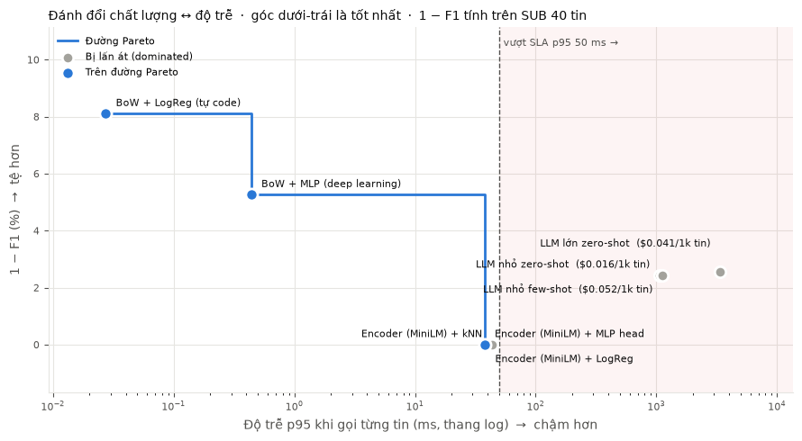

    # Báo cáo cá nhân — Day 01: Lọc tin nhắn rác bằng ML, DL, Embedding và LLM

> Đổi tên file này thành `MSSV_HoTen.md` của bạn, ví dụ `2A20260000_NguyenVanAn.md`, rồi điền từng mục. Xoá các dòng hướng dẫn in nghiêng khi xong.

- **MSSV:**
- **Họ và tên:**
- **SEED** (in ở ô đầu notebook):

## 1. Bằng chứng

| Tệp | Có? |
| --- | --- |
| [`day01_lab.ipynb`](day01_lab.ipynb) — notebook đã chạy, còn output | ☐ |
| [`lab1_report.json`](lab1_report.json) — do ô "Báo cáo cuối" sinh ra | ☐ |
| [`hand_calc.jpg`](hand_calc.jpg) — ảnh tính tay có các bước | ☐ |

## 2. Kết quả chính

*Chép bảng so sánh cuối Phần 5 (F1 test, F1 SUB 40, p95 ms/tin, USD/1k tin) của chính bạn.*

Trên đường Pareto: ['1. BoW + LogReg (tự code)', '2. BoW + MLP (deep learning)', '3c. Encoder (MiniLM) + MLP head']
Đạt SLA p95 < 50 ms: ['1. BoW + LogReg (tự code)', '2. BoW + MLP (deep learning)', '3a. Encoder (MiniLM) + kNN', '3b. Encoder (MiniLM) + LogReg', '3c. Encoder (MiniLM) + MLP head']

## 3. Dự đoán và thực tế

*Chọn 3 dự đoán `predict(...)` lệch nhiều nhất so với kết quả. Mỗi cái: bạn đoán gì, ra gì, vì sao lệch.*
    Dự đoán 1:  hard_eval
     -  Dự đoán Accuracy: BoW còn khoảng 0.80–0.83, Embedding khoảng 0.90, LLM khoảng 0.9, Nhóm khó nhất với BoW là né từ khoá, với LLM là       prompt injection.
    - Kết quả:
        Accuracy: BoW chỉ còn 0.50–0.60 (LogReg 0.50, thấp hơn cả việc luôn đoán spam là 0.58). Embedding 0.60–0.68. LLM 0.98–1.00.
        Nhóm khó nhất với cả BoW (0–10%) và LLM (90%) là spam giọng tự nhiên. LLM chống được 100% prompt injection
     -Vì sao lệch:
          BoW lại nghiêng mạnh về ham (precision 1.0, recall 0.84), nên nó bỏ sót gần hết spam không có từ khoá
          Với LLM,  đánh giá thấp khả năng chống prompt injection khi tin nhắn được đặt trong dấu """, và không lường trước rằng spam giọng tự nhiên mơ hồ ngay cả với người đọc
          Lấy điểm trên tập test cùng phân phối làm mốc, mà điểm đó quá lạc quan
 Dự đoán 2: tradeoffl
     -  Dự đoán LLM nhỏ zero-shot nằm trên đường Pareto vì ít lỗi nhất. Cả 3 cách LLM nằm bên phải vạch SLA.
    - Kết quả:
        Đường Pareto gồm 1. BoW + LogReg (p95 0.03 ms), 2. BoW + MLP (0.44 ms) và 3c. Encoder + MLP (37.8 ms, F1 SUB = 1.0).
        Không có LLM nào trên đường Pareto. 4a bị 3c lấn át: chậm hơn khoảng 28 lần (1066 ms so với 38 ms) mà còn sai nhiều hơn (0.976 so với 1.0).
        Phần SLA đoán đúng: 3 cách LLM vượt SLA, các model cục bộ đều dưới 50 ms (3a sát ngưỡng với 43 ms
     -Vì sao lệch:
         SUB quá nhỏ: chỉ 1 tin sai đã làm LLM bị lấn át.
         Số liệu thật trên đúng tập đang so sánh, không suy từ ấn tượng chung về LLM
 Dự đoán 3:  llm_models
     -  Đoán:
        (1) Model lớn nhỉnh hơn khoảng 0–0.05.
        (2) Model lớn đắt gấp khoảng 2.5 lần.
        (3) LLM thắng 3b một chú
     -Kết quả:
        (1) Model lớn không hơn: 0.974 so với 0.976 của model nhỏ, trong khi p95 chậm hơn khoảng 3 lần (3392 ms so với 1066 ms).
        (2) Đúng: đắt hơn 2.5 lần.
        (3) Sai: trên cùng tập SUB, 3b đạt F1 1.0, còn LLM 0.976. LLM thua cả về chất lượng, tốc độ lẫn chi phí.
      - Vì sao lệch:
        Lọc spam là bài toán dễ, model nhỏ đã đạt trần, nên model lớn không có chỗ để làm tốt hơn.
        Mình còn so sai tập: đem F1 của LLM trên SUB (40 tin cân bằng) so với F1 của 3b trên toàn bộ tập test (0.966). Khi so trên cùng tập SUB, 3b mới là bên thắng.

## 4. Phân tích 50 case khó

*Model nào tụt nhiều nhất, ở nhóm case nào? Nêu 2 case cụ thể và cơ chế khiến model sai.*

Model tụt nhiều nhất: 1. BoW + LogReg ở case Spam giọng tự nhiên

Case 1: id 11, Spam giọng tự nhiên (thật: spam → BoW đoán ham)
"Hey it's Jess from the gym 😊 we're doing a members-only thing this week, 3 months for the price of 1, just reply JOIN and I'll sort it"

Cơ chế:

BoW chỉ thấy các token rời rạc: hey, it's, from, gym, we're, doing, thing, this, week, months, price, reply, join…
Phần lớn là từ thường gặp trong tin nhắn bạn bè, nên trọng số học được nghiêng về ham.
Ý quảng cáo nằm ở cách các từ ghép lại ("3 months for the price of 1"). BoW đã bỏ thứ tự từ, nên chỉ thấy 5 token rời nhau, không token nào mang nghĩa "khuyến mãi".
Không có từ khoá spam quen thuộc (free, win, prize, txt, claim), nên tổng điểm âm và model đoán ham.
Case 2: id 14, Spam giọng tự nhiên (thật: spam → BoW đoán ham)
"Hi, I'm working from home and making about £300 a day, happy to show you how, no experience needed, just text me back"

Cơ chế:

Câu này có vài tín hiệu spam (£300, text), vậy mà BoW vẫn đoán sai. Điều đó cho thấy model nghiêng mạnh về ham:
Tập train có khoảng 87% ham, và trên test BoW có precision 1.0 nhưng recall chỉ 0.84.
Một tin phải chứa nhiều từ khoá spam mạnh cùng lúc mới vượt ngưỡng 0.5.
£300 có thể không trùng token với các số tiền trong vocab (spam cũ hay dùng £1000, £500), nên gần như vô nghĩa với model.
Các từ như working, home, happy, show, experience, back đều mang trọng số ham. Chúng áp đảo hai tín hiệu spam yếu.
BoW không hiểu mẫu lừa "kiếm tiền tại nhà, không cần kinh nghiệm". Mẫu này chỉ nhận ra được khi hiểu ý nghĩa cả câu, không phải từng từ.

## 5. Thử thách cá nhân

*Đề theo SEED của bạn, cách làm, kết quả, giải thích.*

## 6. Phương án cho sản phẩm thật

*Với yêu cầu p95 < 50 ms/tin cho 10 triệu SMS/ngày: chọn phương án nào, dẫn số liệu nào, chấp nhận đánh đổi gì.*
Bảng số liệu
Cách | F1 test | Acc 50 case khó |  USD/1k tin |
|---|---|---|---|
| BoW + LogReg| 0.911  | 0.50 |  	0
| BoW + MLP| 	0.919  | 0.60 |  	0
| Emb + kNN| 0.905  | 0.68 |  	0
| Emb + LogReg| 0.966  | 	0.60 |  	0
| Emb + MLP| 0.951  | 	0.64 |  	0
| LLM nhỏ zero-sho| 0.976*  | 0.98 |  	0.016
| LLM lớn zero-shot| 0.974  | 1 |  	0.041

4b. LLM lớn zero-shot	0.974*	3392	❌	—	0.041
Chọn:  Emb + MLP
 Vì: 
    Chi phí. 3b chạy cục bộ, chỉ tốn tiền server. Dùng LLM 4a sẽ tốn khoảng $4.800/tháng (10.000 × $0.016 × 30) mà vẫn không đạt SLA.
     F1, precision và recall đều cao. So với BoW, 3b hơn khoảng 0.05 F1
Đánh đổi
    Kém bền với spam kiểu mới: Acc 50 case khó: 3b 0.60 so với LLM 0.98; spam giọng tự nhiên chỉ 10%
    Vẫn còn lỗi trên dữ liệu thường: Precision 0.980, recall 0.952 → ước lượng khoảng 25.000 tin chặn nhầm và 62.000 spam lọt mỗi ngày

## 7. AI log và điều đã học

*Mỗi lần dùng AI: hỏi gì, nhận gì, bạn sửa gì. Sau đó 2–3 câu: điều bạn hiểu ra hôm nay mà trước đó chưa hiểu.*  
| Phần | Bạn hỏi AI gì (prompt) | AI trả lời/viết gì |  điều bạn hiểu |
|---|---|---|---|
| Phần 0–3 (vùng tự code)| hỎI về khái niệm kết quả  | AI chỉ giải thích khái niệm, gợi ý hướng làm và giải thích kết quả. | Hiểu được sâu hơn về các khái niệm cách triển khai một mô hình   |
|Phần 4|Hỏi các fix lỗi hỗ trợ viết các hàm call_openai, build_classification_prompt, parse_label, llm_classify_batch fix các lỗi out thất bại|AI hỗ trợ viết call_openai, build_classification_prompt, parse_label, llm_classify_batch, cấu hình provider Gemini và đọc key từ .env, AI phát hiện lỗi 400: gemini-3.8-flash không nhận reasoning_effort="minimal", nên đổi thành "low", AI phát hiện lỗi: parse_label('Not spam') trả về spam, nên sửa bằng cách kiểm tra "not spam" trước.|gemini-3.8-flash không nhận reasoning_effort="minimal", nên đổi thành "low"  |
